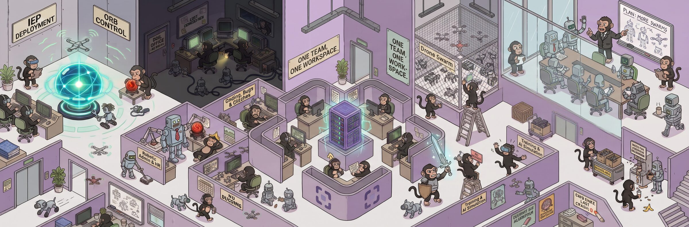

<h1 align="center">Bad Monkey</h1>

<strong>Intelligent software. Wild ideas.</strong>

  

  <a href="https://www.badmonkey.ai/">Website</a> ·
  <a href="https://www.badmonkey.ai/agentspaces/">AgentSpaces</a> ·
  <a href="https://www.badmonkey.ai/agentspaces/developer-guide.html">Developer guide</a> ·
  <a href="https://github.com/badmonkeyai/agentspaces-example-apps">Examples</a>

We build software for **agents, services and people working together**, from the edge to the enterprise. Our open-source foundation is **AgentSpaces**: a peer-to-peer coordination fabric that lets programs discover capabilities, share state and get work done together.

## Give your agents their own space

A peer is a process. A group is its workgroup. A space is the shared board where peers write typed records, take work and publish results. Each peer keeps its own replica; no central broker sits between them. Largely a combo of Jini and JXTA, prior P2P specs.

- **Coordinate work:** write, read, take and subscribe to records under leases.
- **Discover capabilities:** signed, leased cards describe the agents, data, tools, models and apps available to a group.
- **Share what matters:** content-addressed data moves through the swarm to the peers that need it.
- **Bring your stack:** use the languages and frameworks you already work with.

**[Start with AgentSpaces →](https://github.com/badmonkeyai/AgentSpaces)**

## Four cards. One fleet.

| Card | What it describes |
| :--- | :--- |
| **AgentCard** | An agent's goals, the work it takes, its actions and conversations. |
| **AssetCard** | Data, files and tools a peer offers, and how to read or call them. |
| **ModelCard** | A model's tasks, capabilities, provenance and serving peers. |
| **AppCard** | An application for people: its UI, actions and where to open it. |

Cards advertise capabilities. The group's runtime, permissions and policies determine what a caller can actually use.

Bad Monkey's enterprise product operationalizes all 4, providing a way to assemble P2P agents and processes that use one or more cards into groups and networks. Included in the enterprise version are configurable guard rails, rule processing, workflow across peers, and more. This leverages the same underlying AgentSpaces. The 1986 Bell Labs paper, Linda, our follow-on in 1996-2006 at Bell Labs with Sun Microsystems on Jini and JXTA showed us that this is a robust way to build distributed applications.

## Pick a starting point

| I want to… | Start here |
| :--- | :--- |
| Build a peer or understand the fabric | **[AgentSpaces](https://github.com/badmonkeyai/AgentSpaces)** — the Java core, programming model and examples. |
| Explore in a notebook | **[Groovy console](https://github.com/badmonkeyai/agentspaces-groovy)** — Groovy and Clojure notebooks for data, models, cards and workflows. |
| See a fleet working together | **[Example applications](https://github.com/badmonkeyai/agentspaces-example-apps)** — end-to-end examples to study and adapt. |
| Bring coding agents into a group | **[Harness plugins](https://github.com/badmonkeyai/agentspaces-harness)** — integrations for coding-agent harnesses. |
| Publish interfaces for people | **[A2UI](https://github.com/badmonkeyai/agentspaces-a2ui)** and **[React renderer](https://github.com/badmonkeyai/agentspaces-a2ui-react)** — AppCards and agent-driven interfaces. |
| Implement or inspect the protocol | **[Specification](https://github.com/badmonkeyai/agentspaces-spec)** — the shared wire contract. |

### Your language. Your framework.

**Languages** · [Java](https://github.com/badmonkeyai/AgentSpaces) · [Python](https://github.com/badmonkeyai/agentspaces-python) · [TypeScript](https://github.com/badmonkeyai/agentspaces-typescript) · [Ruby](https://github.com/badmonkeyai/agentspaces-rb) · [Rust](https://github.com/badmonkeyai/agentspaces-rust) · [Clojure](https://github.com/badmonkeyai/agentspaces-clj) · [Groovy](https://github.com/badmonkeyai/agentspaces-groovy) · [Babashka](https://github.com/badmonkeyai/agentspaces-bb)

**Frameworks** · [Spring AI](https://github.com/badmonkeyai/agentspaces-springai) · [LangChain4j](https://github.com/badmonkeyai/agentspaces-langchain4j) · [Micronaut](https://github.com/badmonkeyai/agentspaces-micronaut)

**Find your peers** · [Bootstrap discovery](https://github.com/badmonkeyai/agentspaces-bootstrap) · [Beacons](https://github.com/badmonkeyai/agentspaces-beacon)

## Join the troop

Build something small, connect a second peer, and see what they can do together. Questions, bug reports, examples and contributions are welcome in the relevant project's issues and pull requests.

**[Explore the repositories](https://github.com/orgs/badmonkeyai/repositories)** · **[Learn about Bad Monkey](https://www.badmonkey.ai/)**

AgentSpaces is licensed under Apache 2.0. See each repository for its license, supported features and release status.
